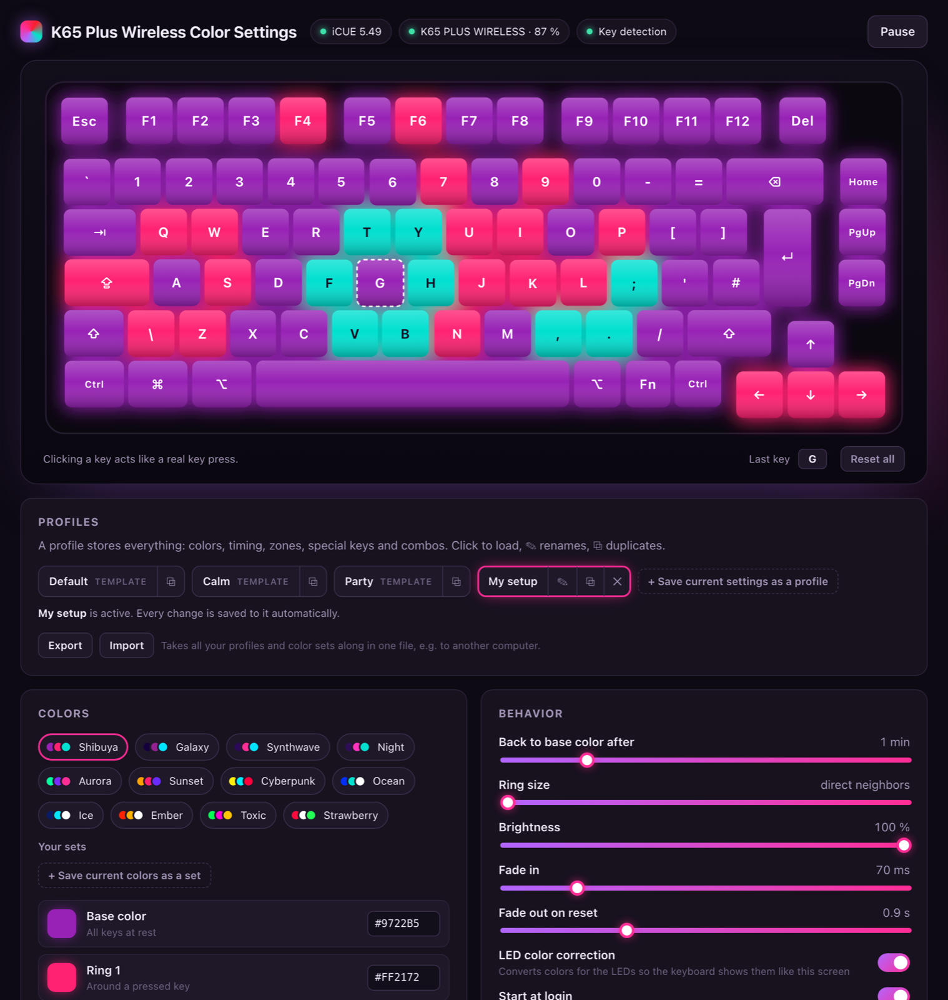

# K65 Plus Wireless Color Settings

**Custom reactive per-key lighting for the Corsair K65 PLUS WIRELESS** on macOS and Windows.
It replaces iCUE's lighting editor with zone-based effects: rings around pressed keys, color
cycling, key-combo effects, animated backgrounds and saved profiles.



**[⬇ Download the latest release](../../releases/latest)** (Windows `.exe`, macOS `.dmg`)

## Features

- **Base color plus rings.** Every key glows in a base color. A key press colors the ring of
  neighboring keys, but only inside that key's zone. Zones: letters, numbers, F-row,
  navigation, arrows, bottom row, all editable.
- **Colors keep moving.** Already colored neighbors advance (ring 1 ↔ ring 2). A pressed colored
  key returns to the base color.
- **Auto reset.** Zones fade back after 1 minute idle. Space and Enter reset letters and numbers
  instantly.
- **Animated background.** While no key is colored, a background effect built from your three
  colors plays: flowing waves, color wave, color fade, breathe or glimmer, with adjustable speed
  and strength. The first colored ring switches it back to a static background.
- **Special keys:**

  | Key | Action |
  |---|---|
  | Backspace | Cycles all colors |
  | Esc | Resets everything |
  | Tab | Sweep |
  | Alt / Ctrl | Wave |
  | Cmd / Win | Sparkle |
  | Caps Lock | Flash |
  | Shift | Rise (a stripe climbs from the bottom row to the top) |

  Modifiers only fire when tapped alone.
- **Key combos:**

  | Combo | Effect |
  |---|---|
  | ⌘ + ⌫ | Wipe that erases the colors as it passes |
  | ⌥ + ⌫ / Ctrl + ⌫ | Wipe only |
  | ⌘ + Space | Wave |
  | ⌘/Alt + Tab | Sweep |

  You can add your own combos.
- **Media keys.** F-key functions (volume, brightness, …) are learned with one click in the
  live preview.
- **Colors that work on LEDs.**
  - 12 presets, starting with **Shibuya** (neon violet, hot pink, cyan teal), plus your own
    color sets.
  - LED color correction converts screen colors to linear LED light, so tones stay distinct
    on the keyboard.
  - A warning appears when two colors would blur together.
- **Profiles:**
  - Save complete setups.
  - The active profile auto-saves.
  - Duplicate, rename, import and export (e.g. to take them to another PC).
- **Live preview.** Clicking a key acts like a real key press. Keycap labels follow the
  keyboard's layout (e.g. US or German).
- **Starts with your computer.** On first start the app adds itself to the login items and then
  runs quietly in the menu bar / tray. It picks up the keyboard whenever it is connected. You can
  switch this off with *Start at login*.

## Requirements

- **Corsair iCUE** installed and running, with SDK / third-party control allowed in its settings.
  The app talks to the keyboard through Corsair's official iCUE SDK and draws its colors as a
  layer on top. Pausing or quitting shows your iCUE lighting again.
- Keyboard connected by **cable or the 2.4 GHz receiver**. iCUE does not control lighting over
  Bluetooth.
- **macOS:** allow *Input Monitoring* (the app asks on first start).

Other Corsair keyboards that iCUE supports may work too. The layout and zones adapt to the LEDs
the SDK reports, but only the K65 PLUS WIRELESS has been tested.

## Installation

| System | Download | First start |
|---|---|---|
| Windows 10/11 | `…-setup.exe` (installer) or `…-portable.exe` (single file) | If SmartScreen appears: *More info → Run anyway* |
| macOS 11+ | `…-macos-universal.dmg` (Apple Silicon and Intel) | Move to Applications, then right-click → *Open* (or *System Settings → Privacy & Security → Open Anyway*) |

The builds are not signed with a paid certificate, which is why the OS asks once. Every release
is built by GitHub Actions from this repository, and `SHA256SUMS.txt` lists all checksums.

### About the iCUE SDK

Corsair's SDK license does not allow redistribution, so it is **not included** here. On first
start, the app downloads iCUE SDK 4.0.84 once from
[Corsair's official GitHub release](https://github.com/CorsairOfficial/cue-sdk/releases/tag/v4.0.84).
It checks the SHA-256 checksum and stores the SDK in your user data folder:

- macOS: `~/Library/Application Support/K65 Plus Wireless Color Settings`
- Windows: `%LOCALAPPDATA%\K65 Plus Wireless Color Settings`

## Privacy

The app reads **which key** was pressed, only to light up the keyboard. It never records text,
sends no telemetry, and connects to the internet only for the one-time SDK download. Settings
stay on your computer:

- macOS: `~/Library/Application Support/io.github.dascoco0811.k65-plus-wireless-color-settings/`
- Windows: `%APPDATA%\io.github.dascoco0811.k65-plus-wireless-color-settings\`

## Building from source

Requirements: Node.js 20+ and Rust (stable).

```bash
npm ci
npx tauri dev                    # run in development
npx tauri build --bundles app    # macOS app
npx tauri build --bundles nsis   # Windows installer (on Windows)
```

Tests and hardware tools:

```bash
cd src-tauri
cargo test -p k65-color-core                           # logic, layout, combos, import/export
cargo run -p k65-color-core --example hwtest           # colors the real keyboard and reads it back
cargo run -p k65-color-core --example readback -- S F1 # only reads colors
cargo run -p k65-color-core --example keylog -- 60     # shows what special/media keys send (macOS, never logs text)
```

| Path | Contents |
|---|---|
| `src-tauri/core` | Core without Tauri: iCUE SDK binding and download, layout and neighbors, light engine, combos, keyboard input (macOS event tap, Windows low-level hook) |
| `src-tauri/src` | Tauri shell: tray, window, commands |
| `src` | UI (React): live preview, colors, profiles, zones, special keys |

## License

[MIT](LICENSE) for the code in this repository. The iCUE SDK belongs to Corsair and is subject
to Corsair's license; it is downloaded from Corsair at runtime and not part of this project.

Not affiliated with or endorsed by Corsair. Corsair, iCUE and K65 are trademarks of Corsair
Memory, Inc.
